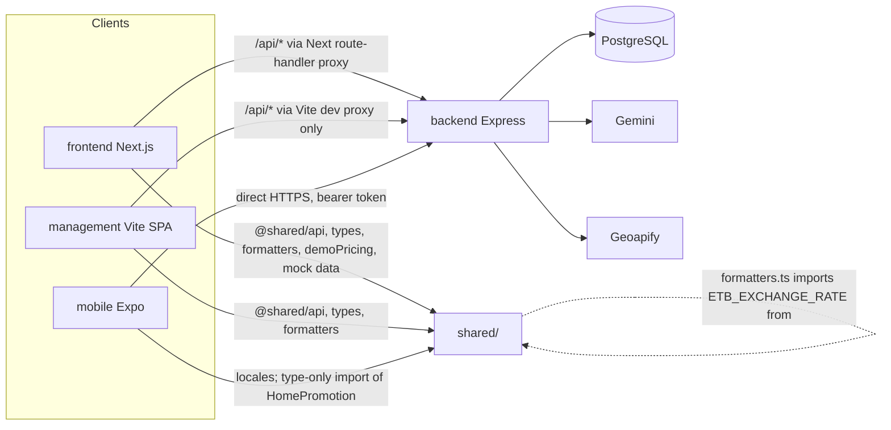

# Current-State Architecture Assessment

| | |
|---|---|
| **Date** | 2026-11-25 |
| **Branch assessed** | `Add-multi-language` working tree (includes uncommitted i18n work) |
| **Baseline commit** | `91031c5` |
| **Status** | Discovery complete. Findings verified against source; see [technical-debt-register.md](technical-debt-register.md) for the itemized list. |

Line numbers refer to the working tree on the date above. `backend/index.mjs` is written as very long single lines, so one line number can cover a whole route handler.

---

## 1. What the system is

Meraki Homes is an Ethiopian home-services marketplace with a managed-service model. Customers (signed in or guests) **request** a service (cleaning, plumbing, childcare, cooking, and others). Operations staff review the request, assign verified professionals ("workers"), propose price, schedule or worker changes, and move the booking through a lifecycle. Customers approve or reject those proposals. Payment is **simulated** (Telebirr, CBE and eBirr demo flows). An AI assistant called "Agaz" (Google Gemini) answers questions and recommends services. Professionals have a small mobile surface for their assignments and live location sharing.

The domain is moderately complex. The hard parts are scheduling, eligibility and assignment, multi-item bookings, approval workflows and auditability. Traffic is low to moderate, and a small team maintains it.

## 2. Applications and technology

| Application | Path | Stack | Runtime / hosting (from config) |
|---|---|---|---|
| API | `backend/` | Node.js ESM (`.mjs`, untyped JS), Express 4.22, `pg` (raw SQL, no ORM) | Railway (`railway.json`: `npm start`, health check `/api/health`) |
| Public website and booking | `frontend/` | Next.js 16 App Router, React 19, Tailwind 4, next-intl (en/am), Leaflet | Vercel (`frontend/vercel.json`) |
| Staff portal | `management/` | Vite 6 + React 19 SPA | **Hosting not defined.** API is reached only through the Vite dev proxy (`management/vite.config.ts:17`). |
| Mobile app | `meraki-homes-mobile/` | Expo SDK 58, expo-router, TanStack Query, TS 6.0 (separate `package.json` and lockfile) | EAS (`eas.json`) |
| Shared code | `shared/` | TypeScript: API client, types, formatters, demo pricing, locale catalogs, mock data | Imported through `@shared/*` path aliases |
| Database | — | PostgreSQL 16 (Docker Compose locally); tests use PGlite (in-process WASM Postgres) | Railway Postgres (inferred) |

**Third parties:** Google Gemini (`@google/genai`), Geoapify geocoding, OpenStreetMap tiles, Google Maps (mobile native).

**Build and tooling:** one root `package.json` (named `react-example`, an AI Studio template leftover) holds the dependencies for backend, web and management. `npm run lint` is `tsc --noEmit` only; there is no ESLint or Prettier. Tests use the `node:test` runner through `tsx`. There is no active CI (`.github/workflows/ci.yml.proposed` exists but is not enabled).

## 3. Repository structure and module responsibilities

```
backend/
  index.mjs              902 lines; ~78k tokens. Pool, migration runner, auth/crypto, CORS, rate limiting,
                         83 route handlers, eligibility SQL, error handler, server bootstrap
  professionals.mjs      854 lines. 12 routes: professional auth, nearby discovery, location sharing
  agaz-gemini.mjs        Gemini resilience (retry/backoff/fallback). Clean and tested.
  geo.mjs                Haversine, coordinate validation, Geoapify adapters. Clean and tested.
  i18n.mjs               Locale resolution and localized API error messages
  migrations/001-019     Raw SQL, applied by migrate() in index.mjs
  *.test.mjs             API integration tests on PGlite
  seed-demo, create-staff, verify-db, smoke-live, migrate*, compare-*   Operational scripts
frontend/
  app/[locale]/[[...slug]]/page.tsx   Single catch-all route that renders the client SPA
  app/api/[...path]/route.ts          Reverse proxy to the Express API
  proxy.ts                            next-intl middleware
  src/App.tsx                         Client-side router (path held in state, if/else view selection)
  src/booking/                        RequestFlow (live booking wizard), account, lookup; plus dead CustomerView/steps
  src/website/                        Marketing pages (MarketingView has its own page state machine)
  src/assistant/                      Agaz chat widget
  src/i18n, components, contexts, types
management/
  app/                   Vite entry (index.html, main.tsx)
  src/ManagementApp.tsx  55 lines / 33.5 KB: 12 page components, router, 56 useState calls
  src/*Workspace.tsx, BookingDetailModal.tsx   Live screens
  src/AdminView, WorkerView, AuditReportView, LiveOperationsPanel, cms/, safety/   Dead (never imported)
meraki-homes-mobile/
  app/                   expo-router screens (live)
  src/lib/               API client, query client, types (live)
  src/components/*Tab.tsx, BookingModal.tsx, main.tsx, App.tsx, index.html, vite.config.ts
                         Dead AI Studio web prototype (excluded from typecheck by a hand-curated include list)
shared/
  api.ts                 Fetch wrapper plus every customer, management and upload client
  types.ts               Prototype-era domain types (drifted from the API)
  demoPricing.ts         Hard-coded ETB price table for the 8 launch services
  utils/formatters.ts    Locale-aware money and date formatting
  data/mockServices.ts   Mock data; also holds the real ADDIS_NEIGHBORHOODS list and the ETB exchange rate
  data/auditData.ts      UX-audit content (dead)
  locales/               en/am message catalogs, config, loader
scripts/                 Dev orchestration, local env generation, i18n checks
```

## 4. Dependency relationships



Observations:
- The backend shares **no** code with the clients. Request and response shapes are defined three times: backend SQL aliases, `shared/api.ts` / `shared/types.ts`, and `meraki-homes-mobile/src/lib/types.ts`.
- There are no import cycles between applications. Within `shared/`, production formatting code depends on the mock-data module (`shared/utils/formatters.ts:2`).
- Mobile is linked to the root package through `"react-example": "file:.."` (`meraki-homes-mobile/package.json:28`), and Metro also resolves from the root `node_modules`.

## 5. Database architecture and data ownership

PostgreSQL schema built by 19 forward-only migrations (`backend/migrations/001`–`019`). About 60 tables, grouped by domain:

| Domain | Main tables |
|---|---|
| Catalogue | `services`, `service_packages`, `service_pricing_rules`, `service_questionnaire_versions`, `service_questions`, `service_question_options`, `service_areas`, `skills`, `service_skill_requirements` |
| Customers | `customers`, `customer_contacts`, `customer_addresses`, `customer_auth` |
| Bookings | `bookings`, `booking_items`, `booking_item_answers`, status histories, `booking_reschedule_proposals`, `booking_price_proposals`, `booking_change_proposals`, legacy `rescheduling_requests` / `price_change_requests`, `quotations`, `booking_item_reviews` |
| Workforce | `workers`, `worker_auth`, `worker_services`, `worker_skills`, `worker_availability`, `worker_unavailability`, `worker_availability_exceptions`, `worker_reservations` (GiST no-overlap exclusion), `booking_assignments`, `booking_location_sharing` |
| Staff / RBAC | `staff_users`, `staff_roles`, `permissions`, `staff_role_permissions` |
| Payments | `payments`, `payment_allocations`, `payment_attempts`, `payment_transactions`, `refunds`, … |
| Other | `audit_logs`, `notifications`, `agaz_conversations`, `agaz_messages`, `home_promotions`, `contact_submissions` |

**Strengths.** Money is `NUMERIC(12,2)` throughout. All timestamps are `TIMESTAMPTZ`. Most status columns have CHECK constraints. Parent consistency is enforced with composite FKs (012). Worker double-booking is prevented with an exclusion constraint. Partial unique indexes enforce one default address per customer and one active assignment per item.

**Ownership.** There are no module boundaries in the data layer: every route handler in `index.mjs` and `professionals.mjs` reads and writes any table directly. Several concepts have both a legacy table and a newer one, and the code reads only one of them (for example, availability queries read `worker_unavailability` and never `worker_availability_exceptions`).

**Migrations.** Applied in a transaction per file and recorded in `schema_migrations`. Production does not auto-migrate (`backend/index.mjs:893-897`); an operator runs `npm run db:migrate:production`. The runner has no advisory lock and no checksum, and tests skip the `btree_gist` exclusion constraint (`skipBtreeGist`), so that guarantee is never tested.

## 6. Main request and data flows

### 6.1 Guest or customer booking request

```mermaid
sequenceDiagram
  participant B as Browser (RequestFlow)
  participant N as Next.js /api proxy
  participant E as Express POST /api/bookings
  participant P as PostgreSQL
  B->>N: POST /api/bookings {items[], contact, location, expectedPackagePrice} + Idempotency-Key
  N->>E: forward (all headers, cookies)
  E->>P: load service/package (server price is authoritative)
  E->>P: eligibleWorkers() availability SQL
  E->>P: BEGIN; INSERT bookings, booking_items, answers, status history; COMMIT
  E-->>B: 201 {reference, startingEstimate, ...}
```

Pricing is **server-authoritative**. The client's expected price only triggers a 409 if it is stale. However, the price *shown* before submission comes from `shared/demoPricing.ts`, which is a hard-coded table, not the database (see TD-030).

### 6.2 Operations lifecycle

Staff (cookie `meraki_staff_session`, HMAC token, permission checked against `staff_role_permissions` on **every** request) list bookings, assign workers (advisory lock plus `FOR UPDATE` plus eligibility re-check), and propose reschedules, prices or worker swaps. Customers accept or reject these through `/api/customers/me/approvals`. Booking-level and item-level status transitions are separate state machines in `index.mjs:606-700`.

### 6.3 Authentication

| Actor | Credential | Transport | Revocation |
|---|---|---|---|
| Customer (web) | email + password (scrypt) | HttpOnly `meraki_customer_session` cookie, SameSite=Lax | none (stateless 8 h token) |
| Customer (mobile) | same | Bearer token in SecureStore | none; logout is a no-op (`index.mjs:217`) |
| Staff | email + password | HttpOnly `meraki_staff_session` cookie | effectively immediate, because `is_active` and the permission are re-checked per request |
| Professional | phone + password | cookie + bearer | `workerAuth` re-checks status |

Tokens are a custom `base64url(JSON).HMAC-SHA256` format (`index.mjs:80-81`), compared with `timingSafeEqual`, and typed by `type`.

### 6.4 Agaz assistant

`POST /api/agaz/chat` builds catalogue context, calls Gemini through `agaz-gemini.mjs` (12 s timeout, retries, model fallback), and persists the conversation for customers or hashed anonymous visitor ids. Conversations expire.

## 7. Architectural strengths (preserve these)

1. **Server-authoritative pricing and validation.** Estimates come from the DB; client values are only an optimistic-concurrency check (`index.mjs:329-336`).
2. **Strong data integrity at the DB level:** NUMERIC money, TIMESTAMPTZ, CHECKs, composite FKs, an exclusion constraint against overlapping reservations.
3. **Parameterized SQL everywhere.** No SQL injection found in either backend module.
4. **No customer IDOR found.** Every customer route scopes by `customer_id`; the professional and location-sharing routes check booking ownership or active assignment.
5. **Per-request RBAC for staff,** backed by the database, so permission changes and deactivation take effect immediately.
6. **Careful assignment concurrency:** a transaction-scoped advisory lock per worker, `FOR UPDATE`, and 23P01/23505 mapped to 409.
7. **Idempotency keys** on booking creation and demo payment.
8. **Well-built small modules:** `geo.mjs`, `agaz-gemini.mjs`, `i18n.mjs`, and the mobile `src/lib/api.ts` (timeouts, typed errors, 401 handling, SecureStore).
9. **Meaningful integration tests:** 46 passing tests that exercise real SQL through PGlite and cover auth separation, idempotency, approvals, location consent and RBAC.
10. **i18n foundation:** shared catalogs, ICU parity checking (`scripts/i18n-check.mjs`), locale-aware formatters.
11. **Secret hygiene:** `.env*` is ignored, local secrets are generated by script, mobile map keys go to native config only, and `SESSION_SECRET` length is enforced.

## 8. Architectural weaknesses and technical debt (summary)

The details, with evidence for each item, are in the [technical-debt register](technical-debt-register.md). The main themes are:

1. **A monolithic API file with no internal layering.** `backend/index.mjs` holds infrastructure, auth, validation, business rules, SQL and HTTP concerns in one `createApp` closure of about 775 lines. Lines run up to 4,007 characters. Business rules (booking state machines, eligibility, proposal handling) cannot be unit-tested apart from HTTP and SQL.
2. **Duplicated and diverging business logic.** Two `POST /api/bookings` handlers that disagree (L297 and L372). Two status state machines (item at L608, booking at L648) plus a third place that derives parent status. Two availability SQL copies, and only one guards against midnight wrap-around. Two customer-registration endpoints. Three proposal-table families.
3. **Confirmed correctness bugs** in audit logging, item cancellation, price proposals, demo-payment replay and location sharing (TD-001 to TD-008).
4. **Infrastructure that assumes one process on one host.** In-memory rate limits keyed on `req.ip` without `trust proxy`, so behind the proxy all users share one bucket. Uploads on local disk. No graceful shutdown, no pool timeouts.
5. **Clients that drift from the API.** Three separate type systems. A hard-coded demo price table and a ×120 FX conversion in production paths. The mobile app reuses almost nothing from `shared/`.
6. **Large amounts of dead code.** About 3,200 lines of unreachable prototype code across `frontend/src/booking/CustomerView.tsx` and `steps/`, six management files, and the AI Studio web prototype inside the mobile app. All of it is still typechecked (or deliberately excluded), and it keeps mock data and obsolete types alive.
7. **The App Router is used as a shell.** One catch-all route renders a client-side state router. Consequences: soft-404s, `<button>` navigation that crawlers cannot follow, a client-fetched catalogue, no sitemap or hreflang.
8. **Code formatting that blocks review.** `backend/index.mjs`, `management/src/ManagementApp.tsx` and `BookingDetailModal.tsx` are written as minified-style lines. Diffs are unreviewable, and there is no formatter or linter to prevent this.

## 9. Security and reliability concerns (summary)

| Concern | Status | Ref |
|---|---|---|
| Rate limiting ineffective behind the proxy (no `trust proxy`; all clients share one IP bucket) | Confirmed | TD-010 |
| Unverified phone-number lookup lists up to 50 bookings for any phone; reference + phone allows demo "payments" and receipts with the customer name | Confirmed, documented as "demo" | TD-011 |
| Public professional endpoints return exact live coordinates of opted-in professionals | Confirmed | TD-012 |
| Staff, customer and professional tokens cannot be revoked before their 8 h expiry | Confirmed | TD-016 |
| Staff login timing reveals whether an account exists; no per-account lockout | Potential | TD-017 |
| Anonymous clients can make the API read 12 MB upload bodies (raw parser runs before auth) | Confirmed, minor | TD-018 |
| Next.js proxy forwards all client headers (including `X-Forwarded-For`), has no upstream timeout, keeps `content-encoding` | Confirmed | TD-013 |
| No security headers (CSP, HSTS) on the Next.js app | Potential | TD-019 |
| Invalid UUIDs and duplicate-key errors return 500 | Confirmed | TD-009 |
| Uploads on ephemeral local disk unless a volume is mounted | Confirmed | TD-020 |
| No graceful shutdown; pool has no connection or statement timeout | Confirmed | TD-021 |
| Worst-case Gemini request can hold an HTTP request for more than 100 s | Confirmed | TD-022 |
| `npm audit`: root 0 vulnerabilities; mobile 8 moderate (transitive: glob, minimatch, node-forge) | Measured | TD-047 |

## 10. Testing and deployment maturity

| Area | State |
|---|---|
| Unit tests | Few: formatters, locale loading, Gemini resilience, geo mapping, i18n. Business rules are not unit-testable in their current location. |
| Integration tests | **Good coverage** of API behaviour on PGlite (tests 8–40). Single shared connection, so no concurrency testing; the exclusion constraint is skipped. |
| Frontend tests | One test file, and half of what it tests is dead code. No component tests. |
| Management / mobile tests | None / one file. |
| E2E | None. |
| Static analysis | `tsc --noEmit` for web, management and shared; separate mobile `tsc`. No ESLint or Prettier. Backend JS is not typechecked. |
| CI | **None active.** `ci.yml.proposed` targets Node 20, but some scripts need Node 22. |
| Deployment | Railway (API), Vercel (web; two conflicting `vercel.json` files), management hosting undefined, EAS for mobile with the preview profile pointing at the production API. Manual production migrations. |
| Observability | `console.log` / `console.error` only. Structured logging exists only for Gemini calls. No request ids, metrics or tracing. Health check pings the DB. |

### Baseline validation results (2026-11-25, before any change)

| Command | Result |
|---|---|
| `npm run lint` (`tsc --noEmit`, root) | ✅ exit 0 |
| `npx tsc --noEmit` (mobile) | ✅ exit 0 |
| `npm test` | ✅ 47 tests: 46 pass, 0 fail, 1 skipped (live Geoapify, no key). `i18n:check` passed (687 keys). ~91 s |
| `npm run build` | ✅ Next.js build (`/[locale]/[[...slug]]` SSG, `/api/[...path]` dynamic) + management bundle (334 KB JS / 94 KB gzip) |
| `npm audit` (root / mobile) | 0 / 8 moderate |

## 11. Recommended improvements (summary)

1. **Fix the confirmed correctness and security bugs first** (Phase 1 of the [roadmap](refactoring-roadmap.md)). Most are small, local changes with tests.
2. **Adopt a modular monolith for the API** ([ADR-0001](architecture-decision-records/0001-modular-monolith-backend.md)). Split `index.mjs` into domain modules (catalogue, bookings, workforce, customers, staff, payments, assistant, location), each with routes, a service (business rules) and a repository (SQL). Extract the state machines and eligibility as pure, unit-tested domain functions.
3. **Introduce a shared contracts package** ([ADR-0003](architecture-decision-records/0003-shared-contracts-package.md)) so that request and response types and validation schemas exist once, for the backend and all three clients.
4. **Move the backend to TypeScript incrementally** ([ADR-0002](architecture-decision-records/0002-typescript-backend.md)).
5. **Make the infrastructure correct for a proxied, multi-instance deployment** ([ADR-0005](architecture-decision-records/0005-stateless-api-instances.md)): `trust proxy`, a shared rate-limit store, object storage for uploads, graceful shutdown.
6. **Delete dead code**, then adopt ESLint + Prettier and activate CI ([ADR-0006](architecture-decision-records/0006-quality-gates-and-ci.md)).
7. **Move the public website onto real App Router routes** incrementally ([ADR-0004](architecture-decision-records/0004-app-router-real-routes.md)).
