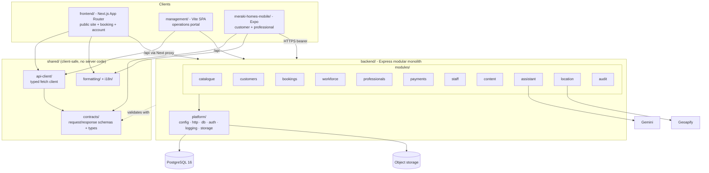
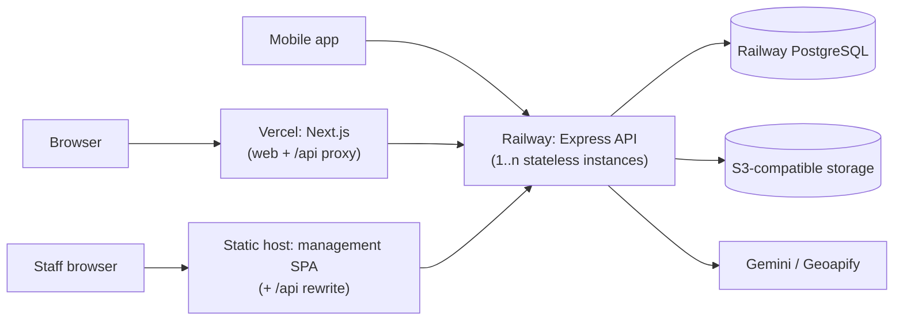

# Target Architecture

| | |
|---|---|
| **Date** | 2026-11-25 |
| **Status** | Proposed. The decisions are recorded as ADRs in [architecture-decision-records/](architecture-decision-records/). |
| **Inputs** | [current-state-assessment.md](current-state-assessment.md), [technical-debt-register.md](technical-debt-register.md) |

## 1. Architectural approach: a layered modular monolith

**Decision.** Keep a single deployable API, the Express + PostgreSQL stack, and the three existing clients. Inside the API, establish explicit **domain modules**. Each module has internal layers (routes → application service → domain rules → repository). Ports and adapters are used **only** at real external boundaries: Gemini, Geoapify, file storage, and future payment and SMS providers.

### Why this fits Meraki Homes

| Option | Assessment |
|---|---|
| **Modular monolith (chosen)** | The team is small, traffic is moderate, and there is one database whose integrity depends on cross-table constraints and transactions (assignment locks, exclusion constraints, composite FKs). One process keeps those guarantees cheap. Module boundaries address the actual problem: a 900-line file in which everything touches everything. |
| Layered architecture alone | Necessary but not sufficient. Splitting `index.mjs` into `routes/`, `services/` and `repositories/` by technical layer would still leave booking logic spread across three global folders. We use layers *inside* modules. |
| Full Clean / Hexagonal everywhere | Wrapping PostgreSQL behind repository interfaces with in-memory fakes adds ceremony and little value. The integration tests already run real SQL on PGlite, quickly. Ports are justified only where the implementation actually varies or is expensive or flaky in tests: external HTTP services and storage. |
| DDD (full tactical) | We adopt the **strategic** parts: bounded contexts as modules, a ubiquitous language (booking, item, assignment, proposal, reservation), and pure domain functions for invariants. We skip aggregates-as-classes, domain events and repositories-per-aggregate, because the domain does not need them yet. |
| Event-driven / CQRS | No requirement for it. There is one database, no read-scaling problem, and no asynchronous integrations yet. When notifications or real payments arrive, a transactional outbox table is the next step, not a message broker. |
| Microservices | Rejected. It would break transactional integrity across bookings, workforce and payments, multiply operational cost, and the team size cannot sustain it. |

## 2. High-level architecture



## 3. Layer responsibilities (inside each backend module)

| Layer | File(s) | Responsibility | May depend on | Must not |
|---|---|---|---|---|
| **Routes** (presentation) | `*.routes.ts` | Map HTTP to a use case: choose the auth middleware, validate input against `shared/contracts`, call the service, shape the response, pick status codes. | service, platform/http, contracts | Contain SQL or business rules; open transactions |
| **Service** (application / use cases) | `*.service.ts` | Orchestrate one use case: transaction boundary, authorization *of the resource* (ownership), call domain rules, call repositories, write audit entries, call external ports. | domain, repository, other modules' **public** services, platform/db, platform/audit | Know about `req`/`res` |
| **Domain** (business rules) | `*.domain.ts` | Pure functions and constants: state machines, pricing and estimate calculation, eligibility ranking, proposal rules, validation of invariants. | nothing except other domain files | Do I/O, import Express, pg or the clock directly (pass `now` in) |
| **Repository** (infrastructure) | `*.repository.ts` | Parameterized SQL for this module's tables. It takes a `Queryable` (pool or transaction client) and returns typed rows mapped to camelCase. | platform/db | Contain business decisions or begin transactions |
| **Adapters** (external ports) | `*.adapter.ts` | Wrap a third-party API behind a small interface (`GeocodingProvider`, `AssistantModel`, `FileStorage`). | platform/config, platform/http-client | Leak provider types to services |

Existing examples that already fit this model: `backend/geo.mjs` is mostly domain plus adapter code, and `backend/agaz-gemini.mjs` is an adapter with resilience. Both move into their modules almost unchanged.

## 4. Module boundaries

| Module | Owns (tables) | Main use cases | Key domain rules |
|---|---|---|---|
| **catalogue** | `services`, `service_packages`, `service_pricing_rules`, `service_questionnaire_*`, `service_question*`, `skills`, `service_skill_requirements`, `service_areas` | Public catalogue, package lookup, staff catalogue CRUD, questionnaire versioning | Package effectivity window; published questionnaire selection; estimate calculation |
| **customers** | `customers`, `customer_contacts`, `customer_addresses`, `customer_auth` | Register / login (cookie and bearer are *transports* of the same use case), profile, addresses, notifications feed | Contact normalization; one default address |
| **bookings** | `bookings`, `booking_items`, `booking_item_answers`, status histories, proposals (`booking_*_proposals`), `booking_item_reviews` | Create request (one handler), lookup, customer approvals, staff status transitions, reschedule, price and worker proposals, reviews | **The single booking/item lifecycle state machine**; proposal supersession; parent-status derivation; idempotency |
| **workforce** | `workers`, `worker_services`, `worker_skills`, `worker_availability*`, `worker_unavailability`, `worker_reservations`, `booking_assignments`, `worker_performance_records` | Worker CRUD, eligibility search, assignment and replacement, reservations | **The single eligibility/availability query**; assignment concurrency (advisory lock); rating recomputation |
| **professionals** | `worker_auth`, `booking_location_sharing` | Professional login, self-profile, nearby discovery, location sharing consent | Location freshness and privacy (rounding public coordinates); two-party consent |
| **payments** | `payments`, `payment_allocations`, `payment_*`, `refunds` | Demo payment, receipts, staff payment list; later a real provider behind a `PaymentProvider` port | Balance and allocation across items in integer cents |
| **staff** | `staff_users`, `staff_roles`, `permissions`, `staff_role_permissions` | Staff login, `/auth/me` with permissions, staff admin | Permission checks; admin-only rules |
| **content** | `home_promotions`, `contact_submissions` | Promotions, contact form and inbox, image uploads | Image URL policy |
| **assistant** | `agaz_conversations`, `agaz_messages` | Chat, conversation history, expiry | Visitor/customer ownership; history truncation |
| **location** | none (cache only) | Address search and reverse geocoding | Ethiopia bounds; coordinate validation |
| **audit** | `audit_logs` | `audit.record(tx, {actorType, actorId, action, entity, reason, metadata})`; staff audit search | Typed actor (no free-text PII) |

**Cross-module rule:** a module calls another module only through that module's `index.ts`, which exports its public service functions and types. It never imports another module's repository or reads another module's tables directly. For example, `bookings.service.createRequest` calls `catalogue.getBookablePackage()` and `workforce.findEligibleWorkers()`.

Pragmatic exception: read-only reporting queries (staff dashboards, booking detail) may join across tables inside the module that owns the *screen*. They must live in a `*.queries.ts` file in that module and stay read-only.

## 5. Dependency rules

```mermaid
flowchart LR
  routes --> service --> domain
  service --> repository --> platformdb[platform/db]
  service --> otherModule["other module (index.ts only)"]
  service --> adapters
  routes --> platformhttp[platform/http]
  routes --> contracts[shared/contracts]
  domain -.x.-> repository
  domain -.x.-> platformdb
```

1. `domain` imports nothing outside `domain` (no I/O, no framework).
2. `repository` is the only layer that writes SQL.
3. `routes` is the only layer that touches `req`/`res`.
4. Modules depend on each other only through `modules/<name>/index.ts`. No cycles: if two modules need each other, extract the shared rule into a lower module or invert the dependency with a callback.
5. `platform/*` never imports from `modules/*`.
6. Clients (`frontend`, `management`, `meraki-homes-mobile`) never import from `backend/`. Everything they share with the server goes through `shared/contracts`.
7. `shared/` contains **no** server-only code, mock data or React components.

These rules are enforced by ESLint `no-restricted-imports` / `import/no-cycle` boundaries (ADR-0006), not just by convention.

## 6. Data access and data ownership

- **Stay with `pg` and handwritten SQL** (ADR-0007). The schema relies on PostgreSQL features (exclusion constraints, partial unique indexes, advisory locks, `FOR UPDATE OF`, JSON aggregation) that the current SQL uses well. An ORM migration would be high-risk and low-value.
- **Repositories** are plain functions: `findBookingForCustomer(q, {reference, customerId})`. `q` is a `Queryable` (pool or transaction client), so the same function works inside or outside a transaction.
- **Transactions are owned by services** through one helper: `withTransaction(pool, async tx => …)`. It handles BEGIN, COMMIT, ROLLBACK (with a guarded rollback) and release. No route or repository begins a transaction.
- **Row mapping:** repositories return camelCase domain objects. SQL aliases do this consistently.
- **Integrity stays in the database:** CHECK constraints for every status column, FKs for every reference, exclusion and partial-unique constraints for concurrency invariants. Application checks give friendly errors; the database is the final guard.
- **Migrations:** forward-only SQL files, run by a migrator that takes an advisory lock, records a checksum, and refuses duplicate prefixes. Production migrations stay manual and explicit. Scripts never migrate implicitly. Constraint additions on populated tables use `NOT VALID` followed by `VALIDATE CONSTRAINT`.
- **Legacy table consolidation** (TD-029) is decided per concept in its own ADR before any data is moved.

## 7. API and integration strategy

- **Contract preservation:** all existing paths, payloads and auth mechanisms remain. Refactoring is internal. Response-shape cleanups (casing, codes) apply to **new** endpoints, and to existing ones only when the consuming clients are updated in the same change.
- **Conventions for new and changed endpoints:**
  - camelCase JSON.
  - Error shape `{ error: { message, code, fields? } }`, where `code` is **always** present and stable (the clients translate it; `useApiErrorMessage` already does).
  - 400 for validation, 401 unauthenticated, 403 forbidden, 404 not found or not owned, 409 conflict or stale state, 422 idempotency mismatch, 429 rate limited, 503 dependency unavailable.
- **Validation:** request bodies, query strings and params are parsed with the shared schema at the route (`validate(schema)` middleware). Services receive typed, validated input.
- **Versioning:** none for now. The API has exactly three first-party clients deployed by this team. Mobile is the only client that cannot be updated in lockstep, so breaking changes need an additive transition period (old and new fields side by side) of at least one mobile release cycle. Introduce `/api/v2` only if a third-party consumer appears.
- **External services:** every outbound call has a timeout, bounded retries with backoff on retryable errors only, and a customer-safe failure message. These are already true for Gemini and Geoapify; keep them true.
- **Future async work** (SMS and email notifications, payment webhooks): a transactional **outbox** table written in the same transaction as the business change, drained by a worker process. No broker until volume requires one.

## 8. Security architecture

| Concern | Target |
|---|---|
| Authentication | One `auth` platform service: scrypt passwords (keep), HMAC tokens (keep the format) plus a `session_version` claim checked against the principal row, so logout, password change and deactivation revoke immediately. Cookie (web) and bearer (mobile) are two transports over the same login use case. |
| Authorization | Two levels: (1) **role permission** middleware `requirePermission('bookings.manage')` (exists; keep); (2) **resource ownership** checked in the service (customer owns booking; professional holds active assignment). `/auth/me` returns the permission list so the UI can gate. |
| Input validation | Shared schemas at every route; size limits per route; uploads authenticated *before* the body is read; magic-byte sniffing. |
| Rate limiting | `trust proxy` set to the actual hop count. Limits keyed by client IP **and** account identifier for login. The store moves to PostgreSQL (`rate_limit_buckets`, upsert per window) when there is more than one instance; no Redis until it is needed. |
| Privacy | Public endpoints never return exact coordinates, phone numbers or names of other parties. Booking lookup requires proof of possession (reference + phone at minimum; an OTP when real customers exist). The audit actor is a typed id, not a name or email. |
| Secrets | Environment only; validated at boot by `platform/config` (fail fast on missing or weak values). Nothing secret in `NEXT_PUBLIC_*`, `EXPO_PUBLIC_*` or mobile `extra`. |
| Transport and headers | API: keep the current headers. Web: add CSP (report-only first), HSTS and frame-ancestors in `next.config.ts`. Mobile: cleartext traffic allowed in dev builds only. |
| Demo features | `DEMO_PAYMENTS_ENABLED` and `DEMO_PHONE_LOOKUP_ENABLED` flags, default **off** in production. |

## 9. Error handling and logging

- **Typed application errors** in `platform/http/errors`: `ValidationError`, `NotFoundError`, `ConflictError`, `ForbiddenError`, `DependencyError`. Services throw them; one error middleware maps them, and known PG codes (22P02 → 400, 23505 → 409, 23503/23514 → 400, 23P01 → 409, 40001 → 409 retryable), to the standard error shape and localized message. No `return apiError(...)` deep inside business code.
- **Never leak internals:** 500 responses carry a generic message plus a `requestId`.
- **Structured logging:** one JSON logger (a small wrapper; pino if a dependency is accepted). Fields: `ts`, `level`, `requestId`, `route`, `status`, `durationMs`, `actorType`, `actorId`, `event`. Redact phone, email, name, tokens, coordinates and message content. `X-Request-Id` is accepted from the trusted proxy or generated, and echoed back.
- **Audit log ≠ application log.** The audit log is a business record written in the same transaction as the change.

## 10. Testing strategy

| Level | Scope | Tooling | Priority targets |
|---|---|---|---|
| Unit | Pure domain functions | `node:test` via tsx (existing) | Lifecycle transitions (exhaustive table), estimate and pricing, proposal supersession, eligibility ranking, payment allocation in cents, time-window and midnight logic |
| Integration (API) | Route → service → SQL on PGlite | Existing `api.test.mjs` pattern | Every bug in the TD register gets a regression test; auth and ownership for every customer and professional route |
| Integration (real PG) | Migrations, exclusion constraints, concurrency | One CI job with a PostgreSQL 16 service container | `btree_gist` no-overlap; concurrent assignment; migration replay from empty |
| Contract | Schemas used by both server and clients | Shared schema tests | Backward compatibility for mobile |
| Component | Booking wizard, account approvals | Vitest + Testing Library (proposed) | RequestFlow validation and steps |
| E2E | Critical journeys | Playwright (proposed) | Guest booking → staff assigns → customer approves; staff login and permission gating |

Rules: tests assert behaviour, not implementation; no test is deleted or weakened to make a refactor pass; characterization tests are written **before** a risky refactor (for example, the booking handler merge).

## 11. Deployment and scalability



- **API instances are stateless** (ADR-0005). That requires moving four things out of process memory: rate-limit state (to PostgreSQL), uploads (to object storage), the geocode cache (to PostgreSQL or kept per instance as a best-effort cache, which is acceptable), and `agazInFlight` (to a DB-level guard). Until then, run exactly **one** API instance and document that constraint.
- **Graceful shutdown:** on SIGTERM, stop accepting connections, drain in-flight requests, close the pool, and exit within the platform's grace period.
- **Health:** `/api/health` (liveness plus DB ping) stays. Add `/api/ready` only if the platform distinguishes readiness.
- **Migrations:** a manual, reviewed step before deploying code that depends on them. Backward-compatible (expand → migrate → contract) so the old code keeps running during deploys.
- **Scaling headroom:** at current volumes a single instance with a 10-connection pool is sufficient. The first bottlenecks would be the eligibility query (needs the indexes in TD-028) and Gemini latency (already isolated).

## 12. Architectural trade-offs

| Decision | Benefit | Cost we accept |
|---|---|---|
| Modular monolith | Transactions and integrity stay simple; one deploy | Module boundaries rely on lint rules and review, not process isolation |
| Raw SQL with repositories | Full PostgreSQL power; no ORM migration risk | More SQL to maintain; mapping code by hand |
| Ports only at external edges | Less ceremony | Service tests hit PGlite rather than fakes (slower, but more realistic) |
| Incremental TypeScript for backend | Type safety without a rewrite | A mixed JS/TS period; a build step for production |
| Zod contracts shared with clients | One source of truth, runtime validation | New dependency; bundle cost on mobile (~13 KB gzip) |
| No API versioning | Simplicity | Mobile changes need additive transitions |
| PostgreSQL-backed rate limiting | No new infrastructure | An extra write per limited request |
| Keep the client app directories in place (no `apps/` rename) | No churn in Vercel, Railway, EAS or Metro configuration | Less uniform layout than a greenfield monorepo |
